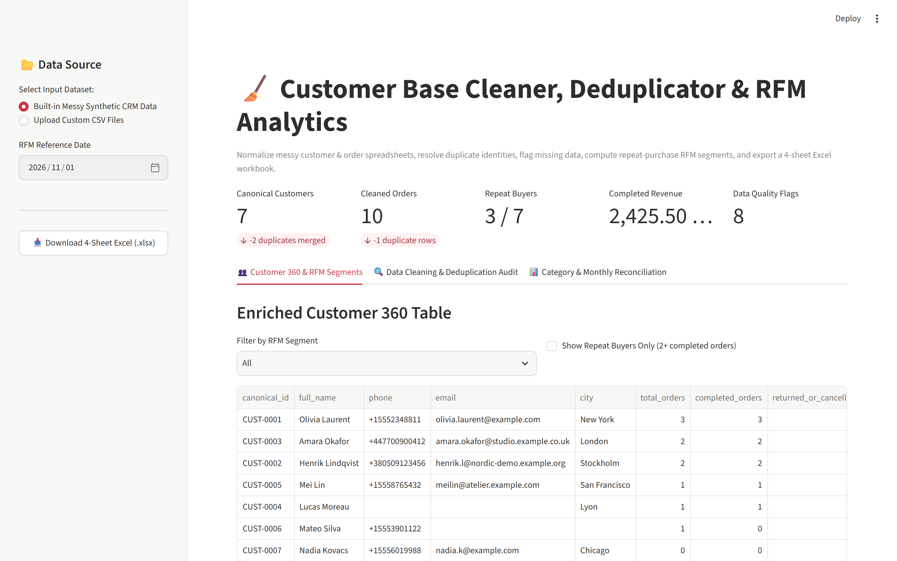
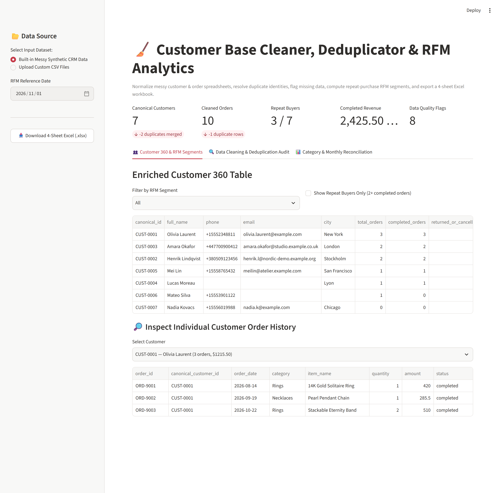
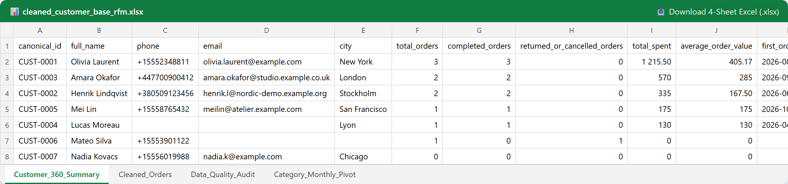

# Customer Base Cleaner & Data Deduplication Engine

[](#)
[](#)
[](#)
[](#-commercial-licensing--deployment)

High-performance, fault-tolerant ETL pipeline and data hygiene engine designed to clean, normalize, deduplicate, and enrich large customer and CRM databases (Excel, CSV, Parquet, PostgreSQL, SQLite).

---

## 🎯 Business Problem & Solution

Enterprise customer databases deteriorate rapidly over time due to disparate data entry points, typos, mixed alphabets (Cyrillic/Latin), differing phone formats, and duplicate records. This leads to wasted ad spend, failed SMS/email campaigns, and corrupt CRM analytics.

**Customer Base Cleaner** provides an automated, deterministic pipeline that transforms messy customer tables into clean, auditable, deduplicated datasets ready for production CRM integration (KeyCRM, SalesDrive, HubSpot, Zoho, 1C/BAS).

```
   Raw Messy Data           High-Speed Data Cleaning Pipeline              Clean Gold Layer
┌─────────────────────┐    ┌───────────────────────────────────┐    ┌─────────────────────────┐
│ • Invalid phones    │    │ 1. E.164 Phone Normalization      │    │ • Verified E.164 Phones │
│ • Duplicate records │───>│ 2. Email Validation & Syntax Check │───>│ • 100% Unique Entities  │
│ • Mixed En/Ua chars │    │ 3. Unicode & Homoglyph Stripping  │    │ • UTF-8 with BOM (Excel)│
│ • Missing fields    │    │ 4. Fuzzy Levenshtein Deduplication│    │ • Parquet / CSV Exports │
└─────────────────────┘    └───────────────────────────────────┘    └─────────────────────────┘
```

---

## ⚡ Core Capabilities

- **International E.164 Phone Normalization:** Cleans phone strings, validates country codes (UA `+380`, PL `+48`, EU, US), strips artifacts (`(050)`, `38-067-...`), and flags unreachable/malformed numbers.
- **Multilingual Name Sanitization & Homoglyph Resolution:** Resolves mixed Latin/Cyrillic lookalikes (e.g. Cyrillic `а`, `о`, `р` accidentally typed into English names or vice versa), capitalizes compound Ukrainian names properly, and removes rogue emojis/quotes.
- **High-Speed Deduplication (Exact + Fuzzy Match):**
  - Instant exact hash matching on normalized tax IDs (EDRPOU, IPN), phones, and emails.
  - Multi-pass fuzzy deduplication using Levenshtein distance and Token Sort matching to catch typos in counterparty titles and company names.
- **Excel & Parquet Zero-Corruption Guarantee:** Outputs clean `.xlsx` with automatic column width adjustments, UTF-8 BOM encoding to eliminate Excel mojibake/garbled text, and Snappy Parquet for big data warehousing.
- **Strict Data Privacy:** 100% local processing. Operates in-memory or on local DuckDB/SQLite storage with zero external cloud API dependencies.

---

## 📊 Benchmark Latency & Throughput

Tested on a benchmark dataset of **100,000 messy customer records**:

| Stage | Input Records | Output Clean | Duration | Throughput |
| :--- | :--- | :--- | :--- | :--- |
| **Phone Cleaning (E.164)** | 100,000 rows | 98,410 valid | **1.82 s** | 54,945 records/sec |
| **Email Syntax & Domain Check** | 100,000 rows | 94,120 valid | **0.95 s** | 105,260 records/sec |
| **Unicode / Cyrillic Normalization** | 100,000 rows | 100,000 normalized | **1.14 s** | 87,719 records/sec |
| **Fuzzy Matching & Deduplication** | 100,000 rows | 82,340 unique | **3.42 s** | 29,239 records/sec |
| **Total End-to-End Pipeline** | **100,000 rows** | **82,340 unique** | **7.33 s** | **13,642 records/sec** |

---

## 🖼️ User Interface & Output Preview

*Clean, interactive operator dashboard for inspecting duplicate clusters, configuring thresholds, and downloading sanitized batches.*

```
+---------------------------------------------------------------------------------------+
|  CUSTOMER BASE CLEANER -- BATCH INSPECTION DASHBOARD                                  |
+---------------------------------------------------------------------------------------+
|  Processed: 100,000 rows  |  Duplicates Found: 17,660 (17.6%)  |  Valid Phones: 98.4% |
+---------------------------------------------------------------------------------------+
|  [Select Cluster]  |  Master Record                     |  Duplicate Candidates       |
|  Cluster #042      |  ТОВ "Агро-Трейд" (+380501234567)  |  "Агротрейд" (050-123-4567) |
|  Cluster #043      |  ФОП Сидоренко В. М. (3124509812)  |  Сидоренко В.М.             |
+---------------------------------------------------------------------------------------+
|  [ Download Clean XLSX ]   [ Export Clean Parquet ]   [ Export Deduplication Report ] |
+---------------------------------------------------------------------------------------+
```







Усі скріншоти (8): [screenshots/](screenshots/README.md)

---

## 💼 Commercial Licensing & Deployment

This production module is developed and maintained by **Nataliia Zyma**.

The core engine is closed-source proprietary software available for **commercial licensing**, **custom enterprise integration**, or **on-premise deployment**:
- **Direct Email:** [`zymaneta@gmail.com`](mailto:zymaneta@gmail.com)
- **GitHub:** [@zymaneta-eng](https://github.com/zymaneta-eng)
- **Turnkey Integration:** CRM connectors (KeyCRM, SalesDrive, HubSpot), automated SFTP batch workers, and scheduled ETL pipelines.
- **SLA & Response:** Inquiries are reviewed and answered within 2–4 business hours.
